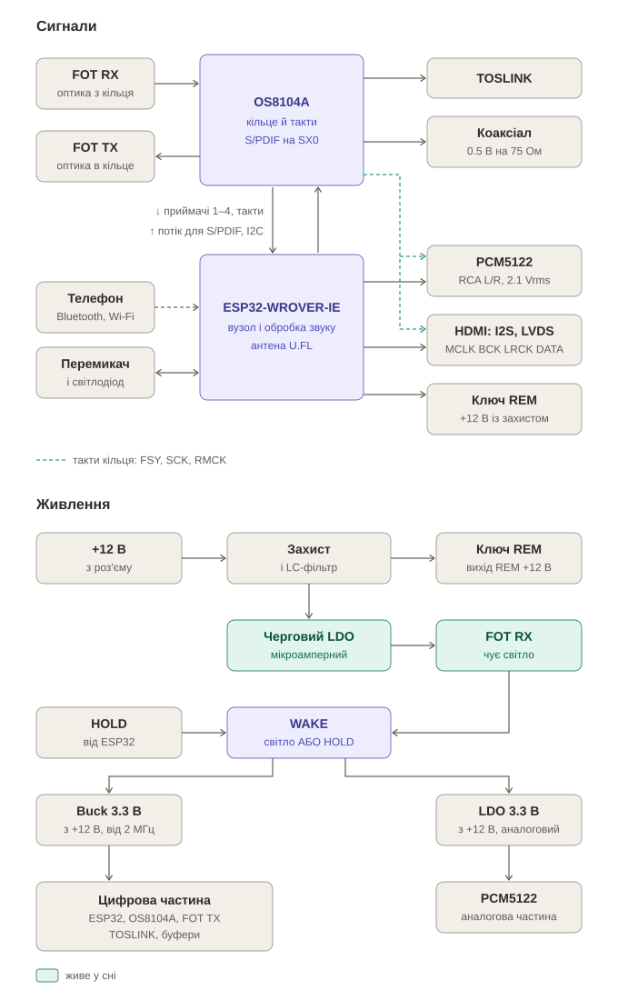

# JLR-MOST-Amp: блок-схема

Блоки пристрою і зв'язки між ними. Що пристрій робить і навіщо, описано в `concept.md`.

## Блоки

**OS8104A**
- Після скидання сам пропускає кільце (All-Bypass). Світло йде далі, поки стартує ESP32.
- Дає такти всьому пристрою: FSY 48 кГц, SCK 64Fs = 3.072 МГц, RMCK 256Fs = 12.288 МГц. Звук іде тільки на тактах
  кільця. Кварц OS8104A — 12.288 МГц.
- Приймачі 1–4 віддає двома лініями, SX1 і SX2. Лінія на 64Fs несе 8 байтів за кадр, а приймачі займають до 12:
  основний AUD3 — 6, три моно — по 2.
- S/PDIF формує сам на SX0 з потоку, який ESP32 подає на SR1. У потоці: звук 24 біти, біти V, U, C і ознака початку
  блоку. Окремий передавач не потрібен. Даташит DS8104AFP4, розд. 7.4.

**ESP32-WROVER-IE**
- Для ГУ відповідає як штатний підсилювач через OS8104A: I2C, INT і RESET. На Connect прописує маршрути приймачів на
  SX1 і SX2.
- I2S0 приймає SX1 і віддає на SR1 потік для S/PDIF. I2S1 приймає SX2 і віддає DOUT на PCM5122 і роз'єм I2S.
- Усі чотири секції I2S ведуть FSY і SCK OS8104A. Вільних I2S не лишається.
- Телефон: Bluetooth A2DP, AirPlay, Spotify Connect. Звук телефона переводиться програмно на такт кільця.
- Керує по I2C PCM5122. Вмикає REM і світлодіод, тримає живлення, читає перемикач і наявність світла.

**Виходи**
- PCM5122 бере RMCK як SCK, тож його PLL не потрібен. Вихід 2.1 Vrms іде прямо на RCA.
- TOSLINK-передавач підключено прямо до SX0. Коаксіал — через буфер, 0.5 В на 75 Ом.
- Роз'єм I2S підключено через буфер на чотири лінії, щоб кабель не навантажував такти PCM5122.

**REM.** Ключ +12 В із захистом від замикання. Вмикає ESP32.

**Перемикач і світлодіод.** Перемикач має положення для типів підсилювача й «зчитати номер». Світлодіод підказує
правильний вибір і показує, що номер зчитано.

**Живлення**
- +12 В постійні з роз'єму штатного підсилювача, на вході захист і LC-фільтр.
- У сні живі тільки черговий LDO з мікроамперним споживанням і FOT RX.
- Світло з FOT RX вмикає buck і аналоговий LDO.
- Світло може зникнути й без команди вимкнення, наприклад коли ГУ перезавантажується. Тому ESP32 тримає живлення
  (HOLD), поки вимкне REM і приглушить ЦАП.
- Buck 3.3 В, від 1 А: Espressif радить для ESP32 джерело від 0.5 А.
  - Частота від 2 МГц, тобто вище СВ-діапазону радіо.
  - Працює від ~4 В на вході, тож переживає пуск двигуна, зокрема стоп-старт.
- PCM5122 живиться від окремого LDO.

**Корпус і антена.** Корпус металевий, як у штатного. Гармоніки тактів кільця потрапляють у FM: 8 × 12.288 =
98.304 МГц. Антена Bluetooth і Wi-Fi виноситься назовні через U.FL.

**Прошивка.** Перша — через контакти UART. Оновлення — по Wi-Fi.

## Відкрите

- FOT RX з виходом наявності світла й малим споживанням у сні: вибір деталі.
- Де в потоці на SR1 OS8104A бере ознаку початку блоку S/PDIF. Уточнюється за розд. 7.4 і 12 даташиту при написанні
  прошивки.
